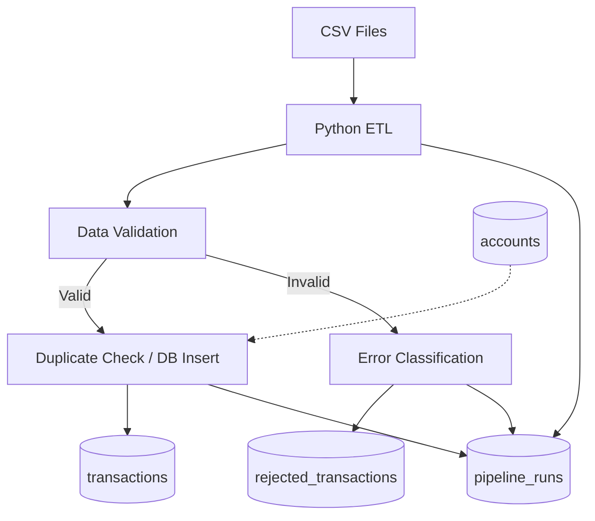

# FinOps Data Platform — Architecture

## 1. System Overview

FinOps Data Platform은 Python과 MySQL 기반의 금융 거래 데이터 ETL 파이프라인이다.

모의 금융 거래 CSV 데이터를 읽고 검증한 뒤, 정상 거래는 데이터베이스에 적재하고 검증 실패 거래는 별도로 기록한다. 또한 중복 적재 방지와 트랜잭션 관리, 파이프라인 실행 이력 추적을 제공한다.

## 2. Data Flow

### Extract

- `src/generate_data.py`: 모의 계좌 및 거래 CSV 데이터 생성
- `src/validate.py`: CSV 파일 읽기 및 거래 데이터 검증

### Transform

거래 데이터에 대해 다음 조건을 검증한다.

- 필수값 누락 여부
- 양의 정수 거래 금액
- 계좌 ID 존재 여부 (CSV 계좌 목록 기준)
- 허용된 거래 유형
- 거래 날짜 형식

검증 결과에 따라 정상 거래와 오류 거래를 분리한다.

### Load

`src/load.py`에서 MySQL 적재를 수행한다.

- `accounts`: 계좌 데이터 저장
- `transactions`: 검증을 통과한 거래 저장
- `rejected_transactions`: 검증 실패 데이터 및 오류 사유 저장
- `pipeline_runs`: 실행 상태 및 처리 건수 기록

## 3. Duplicate Prevention

`transaction_id`를 기본키로 사용한다.

MySQL의 `ON DUPLICATE KEY UPDATE`를 이용하여 이미 존재하는 거래가 중복 삽입되지 않도록 한다.

중복 여부는 거래 금액이나 거래 시각이 아닌 거래 식별자를 기준으로 판단한다.

## 4. Transaction Management

파이프라인은 다음 순서로 실행된다.

1. CSV 데이터를 읽고 검증한다.
2. `pipeline_runs`에 `RUNNING` 상태를 생성하고 COMMIT한다.
3. 계좌, 정상 거래, 오류 거래를 적재한다.
4. 실행 결과를 `SUCCESS`로 업데이트한다.
5. 모든 적재 작업을 COMMIT한다.

적재 중 예외가 발생한 경우:

1. 미확정 데이터 변경을 ROLLBACK한다.
2. 해당 실행 이력을 `FAILED`로 변경한다.
3. 실패 상태를 별도로 COMMIT한다.

이 구조는 적재 과정에서 발생한 장애로 인해 일부 데이터만 확정되는 상황을 방지한다.

## 5. Execution Tracking

`pipeline_runs`는 실행별로 다음 정보를 기록한다.

- Run ID
- Source filename
- SHA-256 source hash
- Start and finish timestamps
- Input count
- Inserted count
- Duplicate count
- Rejected count
- Execution status

정상 완료된 실행은 다음 조건을 만족해야 한다.

`input_count = inserted_count + duplicate_count + rejected_count`

## 6. Current Limitations

- 계좌 존재 검증은 실제 DB가 아닌 CSV 계좌 목록을 기준으로 한다.
- 비정상 프로세스 종료 시 `RUNNING` 상태가 남을 수 있다.
- 전체 메인 실행 경로의 모든 장애 상황을 테스트하지 않았다.
- Batch Insert와 대용량 처리 최적화는 구현하지 않았다.
- 자동 스케줄링 및 모니터링은 지원하지 않는다.

향후 버전에서 자동화, 성능 측정, 장애 복구 기능을 확장할 예정이다.
