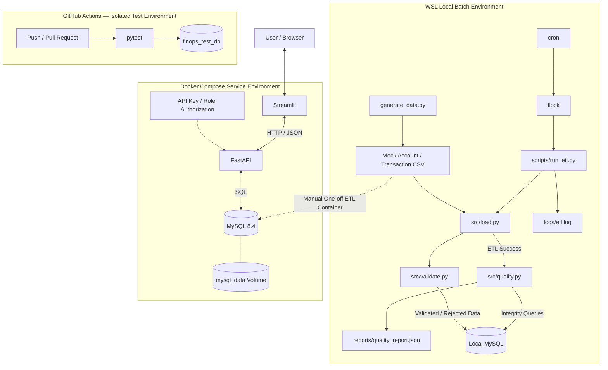
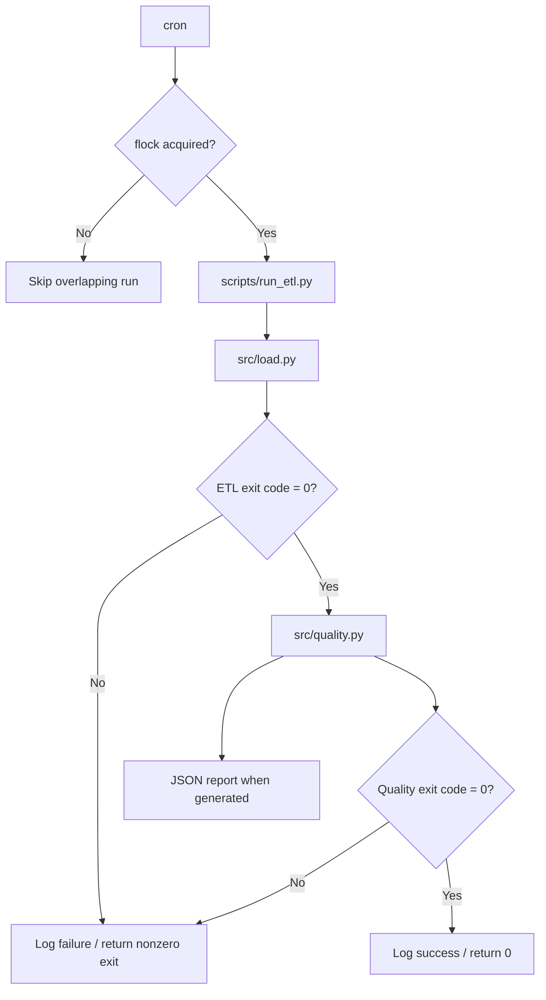
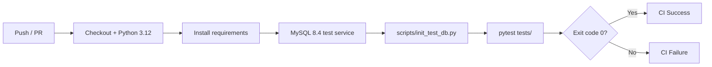
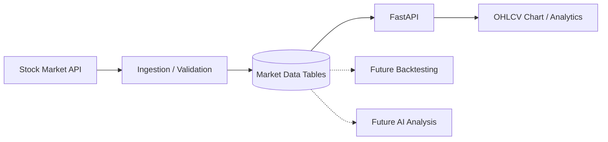

# FinOps Data Platform — System Architecture

## 1. System Overview

FinOps Data Platform은 Python과 MySQL을 기반으로 모의 금융 거래 데이터를 생성·검증·적재하고, REST API와 대시보드를 통해 거래 및 데이터 품질 현황을 조회하는 금융 데이터 플랫폼입니다.

| Version | Architecture Focus |
|---|---|
| V1 | CSV 기반 ETL, 데이터 모델링, 중복 방지, 오류 기록, 트랜잭션 관리 |
| V2 | FastAPI, 인증·인가, Streamlit, Docker Compose, 장애 대응 |
| V3 | SQL 복합 인덱스 최적화, 실패 후 재처리, cron + flock, 데이터 품질 검사, GitHub Actions CI |

현재 모의 금융 데이터를 사용하며 실제 은행 운영 시스템, 실시간 거래 처리 또는 투자 서비스는 구현하지 않았습니다.

## 2. System Architecture

### 2.1 Overall Architecture



WSL 로컬 배치 환경, Docker 서비스 환경, GitHub Actions 테스트 환경을 구분합니다. 현재 cron은 WSL에서 `.venv`의 Python을 실행하며, Docker Compose 내부의 스케줄러가 아닙니다. 로컬 MySQL과 Docker MySQL은 별도 DB 인스턴스일 수 있고 자동으로 동기화되지 않습니다.

### 2.2 Data Flow

**Data Ingestion**

1. `src/generate_data.py`로 모의 계좌 및 거래 CSV를 생성합니다.
2. ETL이 입력을 읽고 `src/validate.py`를 통해 검증합니다.
3. 정상 거래를 `transactions`에 저장하고 기존 거래 ID는 중복으로 집계합니다.
4. 검증 실패 거래를 `rejected_transactions`에 원본 및 오류 사유와 함께 저장합니다.
5. 실행 상태와 처리 건수를 `pipeline_runs`에 기록합니다.
6. 배치 실행 스크립트는 ETL 성공 시 품질 검사를 수행하고 결과 및 종료 코드를 기록합니다.

**Data Retrieval**

1. 사용자가 Streamlit 대시보드에서 조회합니다.
2. Streamlit이 FastAPI에 HTTP 요청을 전송합니다.
3. FastAPI가 API Key와 역할을 확인합니다.
4. FastAPI가 MySQL에 SQL 조회를 수행합니다.
5. 조회 결과를 JSON으로 반환하고 Streamlit이 시각화합니다.

Streamlit은 MySQL에 직접 연결하지 않습니다. 사용자 화면 → FastAPI → MySQL 계층 구조를 유지합니다.

## 3. V1 — ETL Data Pipeline

### 3.1 Extract

`src/generate_data.py`에서 계좌 100건과 거래 10,000건을 생성합니다. 난수 시드를 고정하고 검증을 위한 오류를 의도적으로 포함합니다. 생성된 CSV가 ETL 입력으로 사용됩니다.

### 3.2 Transform & Validation

`src/validate.py`는 다음 항목을 검사합니다.

- 필수 필드 누락 및 공백 문자열
- 양의 정수가 아닌 거래 금액
- CSV 계좌 목록에 존재하지 않는 계좌 ID
- 허용되지 않은 거래 유형 (`DEPOSIT`, `WITHDRAWAL` 외)
- 잘못된 거래 날짜 형식

정상 거래와 오류 거래를 분리합니다. 계좌 존재 여부의 입력 검증은 CSV 계좌 목록을 기준으로 하고, DB 적재 이후에는 외래키 무결성도 검사합니다.

### 3.3 Load & Data Model

`src/load.py`에서 MySQL 적재를 수행합니다.

| Table | Description |
|---|---|
| `accounts` | 계좌 ID, 계좌명, 생성일 |
| `transactions` | 정상 거래 데이터, 거래 ID 기본키, 계좌 외래키 |
| `rejected_transactions` | 오류 거래 ID, 원본 JSON, 오류 유형 및 메시지, 실행 ID |
| `pipeline_runs` | 실행 상태, 원본 파일과 SHA-256 해시, 처리 건수, 시작·종료 시각 |

- Schema: [sql/schema.sql](../sql/schema.sql)
- ERD: [erd.md](erd.md)

### 3.4 Duplicate Prevention & Idempotency

`transaction_id` 기본키와 `ON DUPLICATE KEY UPDATE`를 이용하여 동일 거래 ID의 신규 중복 삽입을 방지합니다. 정상 거래 9,854건, 검증 실패 146건이 포함된 동일 CSV를 재실행한 결과 신규 적재 0건, 중복 9,854건, 검증 실패 146건을 확인했습니다.

정상 거래 테이블의 중복 방지와 전체 실행 기록의 멱등성은 다릅니다. 반복 실행 시 실행 이력과 오류 거래 기록은 추가로 누적될 수 있습니다.

### 3.5 Transaction Management

1. 실행 시작 정보를 `RUNNING`으로 기록하고 COMMIT합니다.
2. 정상 거래와 오류 거래를 적재합니다.
3. 성공 상태와 처리 건수를 갱신하고 COMMIT합니다.
4. 적재 중 예외가 발생하면 미확정 변경 사항을 ROLLBACK하고 가능한 경우 `FAILED` 상태를 별도로 기록합니다.

DB 연결 이전 단계의 장애나 강제 종료에서는 실패 상태 기록이 남지 않을 수 있습니다. 이미 확정된 실행 시작 기록까지 롤백되는 것은 아닙니다.

### 3.6 Execution Tracking

`pipeline_runs`에는 실행 ID, 원본 파일명 및 SHA-256 해시, 시작·종료 시각, 입력·신규·중복·오류 건수와 실행 상태를 기록합니다.

```text
input_count = inserted_count + duplicate_count + rejected_count
```

정상적으로 적재된 실행에서 위 식이 성립해야 합니다. `SUCCESS`는 ETL 적재 성공을 의미하며, 그 이후 수행하는 품질 검사까지 성공했다는 의미는 아닙니다.

## 4. V2 — FastAPI Backend

### 4.1 REST API

| Method | Endpoint | Description |
|---|---|---|
| GET | `/health` | API 상태 확인 |
| GET | `/health/db` | DB 연결 확인 |
| GET | `/api/v1/accounts` | 계좌 목록 조회 |
| GET | `/api/v1/accounts/{account_id}/transactions` | 계좌별 거래 조회 |
| GET | `/api/v1/transactions` | 거래 목록 조회 및 필터링 |
| GET | `/api/v1/analytics/summary` | 거래 통계 |
| GET | `/api/v1/pipeline/runs` | 실행 이력 |
| GET | `/api/v1/data-quality/summary` | 데이터 품질 통계 |

### 4.2 Pagination

```python
page: int = Query(1, ge=1)
size: int = Query(10, ge=1, le=100)
offset = (page - 1) * size
```

SQL `LIMIT`, `OFFSET`을 이용하여 요청당 반환 데이터 수를 제한합니다.

### 4.3 Transaction Filtering

`start_date`, `end_date`, `transaction_type` 필터를 지원합니다. 날짜 범위는 시작일과 종료일을 포함하고, 시작일이 종료일보다 늦으면 HTTP 422를 반환합니다.

### 4.4 SQL Query Handling

MySQL Connector/Python으로 DB에 접근하며 파라미터 바인딩을 사용합니다.

```python
cursor.execute(
    "SELECT * FROM accounts WHERE account_id = %s",
    (account_id,)
)
```

사용자 입력값을 SQL 문자열에 직접 연결하지 않으며 작업 이후 커서 및 연결을 해제합니다.

## 5. Authentication & Authorization

### 5.1 API Key Authentication

`X-API-Key` 요청 헤더를 사용하고, `VIEWER_API_KEY`, `ADMIN_API_KEY`를 환경변수로 관리합니다. 키 비교에는 `secrets.compare_digest()`를 사용합니다. 실제 비밀정보는 저장소에 커밋하지 않습니다.

### 5.2 Role-Based Access Control

| Function | Viewer | Admin |
|---|---|---|
| 거래 내역 조회 | O | O |
| 계좌 정보 조회 | O | O |
| 거래 통계 조회 | O | O |
| 데이터 품질 조회 | O | O |
| 파이프라인 실행 이력 | X | O |

권한 검사는 Streamlit 화면이 아니라 FastAPI 서버에서 수행합니다.

### 5.3 Sensitive Data Masking

Viewer 응답의 계좌 ID는 마지막 네 자리만 표시하도록 마스킹합니다. 이는 데이터 노출 감소를 위한 조치이며 사용자별 계좌 접근통제와는 다릅니다.

### 5.4 Error Handling

| HTTP Status | Description |
|---|---|
| 401 | API Key 누락 또는 불일치 |
| 403 | 접근 권한 부족 |
| 404 | 존재하지 않는 계좌 |
| 422 | 잘못된 요청 파라미터 |
| 503 | DB 연결 장애 또는 인증 설정 오류 |

현재 인증·인가 방식은 학습용 최소 구현이며 실제 금융기관의 운영 보안 수준을 의미하지 않습니다.

## 6. Streamlit Dashboard

| View | Features |
|---|---|
| Overview | 전체 거래 건수·금액, 입출금 건수, 거래 유형 분포 |
| Transactions | 거래 테이블, 날짜·거래 유형 필터, 페이지네이션 |
| Data Quality | 검증 실패 건수, 중복 거래, 실행 횟수·상태, 관리자 전용 실행 이력 |

대시보드는 FastAPI를 통해 데이터를 조회합니다. V3의 JSON 품질 보고서는 배치에서 별도로 생성되며, 보고서 자체를 대시보드에서 직접 표시하는 연동은 현재 구현 범위에 포함되지 않습니다.

## 7. Docker Compose Deployment

### 7.1 Container Architecture

| Service | Technology | Port |
|---|---|---|
| db | MySQL 8.4 | 내부 3306 |
| api | FastAPI | 8000 |
| dashboard | Streamlit | 8501 |

`compose.yaml`에 정의된 세 서비스를 사용합니다. ETL은 기존 API 이미지를 활용한 일회성 컨테이너로 별도 실행할 수 있습니다.

### 7.2 Networking & Startup Dependencies

```text
Browser → Streamlit → http://api:8000 → FastAPI → db:3306 → MySQL
```

컨테이너 간에는 서비스 이름을 사용합니다. MySQL Health Check가 정상화된 후 FastAPI가 시작되며, Streamlit은 API 서비스에 의존합니다.

### 7.3 Configuration & Persistence

Docker 환경은 `.env.docker`, 로컬 환경은 `.env`를 사용합니다. Docker MySQL 데이터는 이름 있는 볼륨 `mysql_data:/var/lib/mysql`에 저장합니다.

`docker compose down`은 일반적으로 이름 있는 볼륨을 유지하지만, `docker compose down -v`는 데이터를 삭제할 수 있습니다. 새 DB에서는 스키마 초기화와 CSV 적재가 필요합니다. 벤치마크용 인덱스가 Docker DB에도 적용되었는지는 별도 확인이 필요합니다.

실행 방법은 [README](../README.md)를 참조합니다.

## 8. Error Handling & Operational Logging

DB 연결 실패 시 `/health/db`는 HTTP 503을 반환하며, MySQL 재시작 후 정상 연결 시 HTTP 200을 반환하는 것을 수동으로 검증했습니다.

Python `logging`을 이용하여 오류 클래스 및 실행 결과를 기록합니다. API Key와 DB 비밀번호 등 비밀정보를 로그에 의도적으로 출력하지 않도록 설계합니다.

V3 배치 실행 로그는 `logs/etl.log`에 저장합니다. DB 연결 자체가 실패할 경우 DB 실행 이력에 기록하지 못할 수 있으므로 외부 실행 로그도 함께 확인해야 합니다.

## 9. V3 — SQL Performance Optimization

MySQL 8.4의 별도 `finops_benchmark_db`에서 거래 100,000건을 대상으로 `EXPLAIN ANALYZE`를 사용해 각 조건을 5회 측정했습니다.

```sql
CREATE INDEX idx_transactions_date_id
ON transactions (transaction_at DESC, transaction_id DESC);

CREATE INDEX idx_transactions_account_date_id
ON transactions (account_id, transaction_at DESC, transaction_id DESC);
```

| Query | Before (mean) | After (mean) | Speedup |
|---|---:|---:|---:|
| 최신 거래 10건 | 138.8 ms | 0.4458 ms | 약 311배 |
| 특정 계좌 최신 거래 100건 | 46.200 ms | 2.075 ms | 약 22.3배 |

첫 번째 실험은 `Table Scan → Sort → Limit`에서 `Index Scan → Limit`로 개선했습니다. 두 번째 실험은 날짜 기반 인덱스의 `Index Scan → Filter → Limit`와 계좌 기반 복합 인덱스의 `Index Lookup → Limit`를 비교했습니다. 해당 실행계획에서 읽은 인덱스 행 수는 7,688건에서 100건으로 감소했습니다.

측정 결과는 특정 데이터셋과 SQL에 한정되며 전체 API 응답시간이나 운영 시스템 전체 성능을 의미하지 않습니다.

상세 자료: [SQL Performance Benchmark](performance.md).

## 10. V3 — Failure Recovery

- 트랜잭션 예외 발생 후 미확정 거래 롤백 검증
- 실패 거래 재처리 및 신규 중복 거래 방지 검증
- MySQL 연결 실패 및 복구 후 API 상태 검증
- Python 프로세스 SIGKILL 종료 코드 137 및 미커밋 테스트 거래 0건 확인

SIGKILL 실험은 단일 INSERT에 대해 수행했습니다. 전체 ETL 강제 종료나 `RUNNING` 상태 자동 복구, 자동 재시도 또는 RTO 측정을 검증한 것은 아닙니다.

상세 자료: [Failure Recovery Report](failure_recovery_report.md).

## 11. V3 — Batch Automation

### 11.1 Scheduling

WSL에서 cron이 매일 02:00에 배치를 실행하도록 설정했습니다. `flock -n`을 사용하여 동일 잠금을 사용하는 배치가 중복 실행되지 않도록 합니다.

```cron
0 2 * * * /usr/bin/flock -n /tmp/finops-etl.lock /absolute/path/to/finops-data-platform/.venv/bin/python /absolute/path/to/finops-data-platform/scripts/run_etl.py
```

실제 환경에 맞게 절대 경로를 변경해야 합니다. WSL 및 cron 서비스가 실행 중이어야 하며 로컬 DB 연결이 가능해야 합니다. 1분 간격 스케줄 실행은 검증했지만 일일 02:00 실행 자체는 아직 별도로 관측하지 않았습니다.

### 11.2 Workflow Dependency



`scripts/run_etl.py`는 `subprocess.run()`으로 각 프로그램을 순차 실행합니다. ETL 성공 시에만 품질 검사를 실행하며 각 단계의 종료 코드를 전달합니다. 품질 검사 실패는 전체 배치의 비정상 종료를 의미하지만 이미 COMMIT된 ETL 데이터를 다시 롤백하거나 `pipeline_runs`의 적재 성공 상태를 변경하지 않습니다.

### 11.3 Technology Decision

현재 워크플로는 작업 의존 관계가 단순하며 로컬 하드웨어 메모리 제약도 있어 Apache Airflow 대신 cron + flock을 유지합니다. Airflow는 설치 또는 실행하지 않았으며 파이프라인 복잡도가 증가할 때 재검토할 예정입니다.

## 12. V3 — Data Quality Monitoring

`src/quality.py`는 MySQL 연결을 공유하여 SQL 기반 품질 검사를 실행합니다.

| Check | Purpose |
|---|---|
| `invalid_amount` | 0 이하 거래 금액 검색 |
| `null_values` | 필수 필드 NULL 검사 |
| `duplicate_ids` | 중복 거래 ID 검사 |
| `invalid_fk` | 계좌 참조 무결성 검사 |
| `pipeline_count_mismatch` | SUCCESS 실행의 입력/처리 건수 정합성 검사 |

검사 건수가 모두 0이면 PASS, 하나라도 0이 아니면 FAIL로 평가합니다. 추가로 최근 실행별 오류율 및 오류 유형별 건수를 집계합니다. 오류율은 현재 모니터링 지표이며 별도의 실패 임계값은 없습니다.

품질 결과는 `reports/quality_report.json`에 저장합니다. 보고서에는 검사 시각, 상태, 검사 결과 및 오류 통계가 포함됩니다. 현재 보고서는 고정 경로에 갱신됩니다.

2026-11-21 실제 로컬 실행 Run 315에서 ETL 성공 → 품질 검사 PASS → JSON 보고서 생성 → 종료 코드 0을 확인했습니다. ETL 실패 시 품질 검사 생략도 실제 연결 장애 상황에서 확인했습니다.

## 13. V3 — Continuous Integration

`.github/workflows/ci.yml`은 main Push 또는 main을 대상으로 하는 Pull Request에서 실행됩니다.



GitHub-hosted Ubuntu runner에서 MySQL 서비스 컨테이너와 별도 테스트 DB를 사용합니다. 로컬 운영 DB 또는 Docker 볼륨의 데이터에 연결하지 않습니다.

정상 main Push에서 CI 성공을 확인했으며 의도적 실패 테스트를 포함한 PR에서도 CI 실패를 확인했습니다. 해당 실험용 PR은 main에 병합하지 않았습니다. 자동 배포 및 필수 병합 차단 규칙은 현재 구현 범위에 포함되지 않습니다.

## 14. Testing & Verification

### 14.1 Automated Tests

| Test Area | Verification |
|---|---|
| Data validation | 정상 거래, 필수 필드, 금액, 계좌, 날짜, 거래 유형 |
| Transaction integrity | DB 롤백, 실패 처리, 재처리 및 중복 방지 |
| Authentication / authorization | API Key, 역할, 마스킹 |
| API behavior | 페이지네이션, 잘못된 입력, 404, 503 |
| Quality evaluation | PASS, 단일 오류, 복합 오류 |
| Batch workflow | ETL 성공/실패, 품질 검사 성공/실패, 호출 횟수와 종료 코드 |

2026-11-21 기준 전체 기존 테스트 29개 통과(경고 1개)를 확인했습니다. 이후 `tests/test_run_etl.py`의 신규 테스트 3개가 별도로 통과했습니다. 추가 후 전체 회귀 테스트 및 CI는 최종 검증 단계에서 확인합니다.

### 14.2 Workflow Verification

| Scenario | Expected | Verification |
|---|---|---|
| ETL success + quality PASS | Exit 0 | 실제 실행 및 Mock 테스트 |
| ETL failure | Skip quality; nonzero exit | 실제 연결 장애 및 Mock 테스트 |
| ETL success + quality FAIL | Exit 1 | Mock 테스트 |

Mock 테스트에서는 실제 subprocess 실행 대신 `CompletedProcess`를 반환하여 호출 횟수와 최종 종료 코드를 검증합니다. 실제 DB에 무결성 위반을 삽입하는 통합 시험과는 구분합니다.

### 14.3 Database Consistency Verification

MySQL Workbench의 직접 집계 SQL과 FastAPI `/api/v1/analytics/summary` 응답에서 `total_transactions`, `total_amount`, `deposit_count`, `withdrawal_count`가 동일함을 수동으로 검증했습니다.

### 14.4 Test Scope

```bash
DB_NAME=finops_test_db python -m pytest tests/ -v
```

테스트용 DB를 별도로 준비하고 연결 설정을 확인한 뒤 실행해야 합니다. API Mock 테스트, 실제 DB 테스트, Docker 수동 장애 실험, SQL 벤치마크는 서로 다른 검증 범위를 가집니다. 전체 시스템의 자동 End-to-End 복구를 검증한 것은 아닙니다.

## 15. Current Limitations & Future Improvements

- 모의 금융 데이터를 사용하며 외부 금융 시장 API는 아직 연동하지 않았습니다.
- 실제 금융기관 수준 인증·인가, 사용자별 계좌 접근통제 및 감사 추적은 미구현입니다.
- CSV 계좌 검증을 실제 DB 상태 기준으로 개선할 여지가 있습니다.
- 전체 ETL 강제 종료 및 비정상 종료 후 `RUNNING` 상태 자동 복구는 미구현입니다.
- COMMIT 중 연결 장애의 결과 확인, 자동 재시도 및 장애 알림은 미구현입니다.
- SQL 조회 최적화는 수행했지만 대량 적재 Batch Insert 최적화 및 처리량 벤치마크는 미완료입니다.
- 데이터 품질 보고서의 이력 보존, 오류율 임계값, 중앙 집중식 모니터링은 미구현입니다.
- cron은 WSL 실행에 의존하며 Docker 내부 스케줄러 및 클라우드 배포는 미구현입니다.
- Docker 환경 최종 재현성 및 인덱스 적용은 별도 확인 대상입니다.
- CI는 구현했으나 자동 배포(CD)는 구현하지 않았습니다.

## 16. Future Architecture — V4

향후 실제 주식 시장 데이터를 수집하여 투자 분석 플랫폼으로 확장할 예정입니다. 기존 모의 거래 데이터와 외부 시장 데이터를 구분하고, 별도의 시계열 스키마와 품질 검증을 설계합니다.



위 구조는 계획이며 현재 구현 성과가 아닙니다. 향후 기술적 지표, 백테스트, 재무·공시 분석 및 근거 데이터 기반 AI 분석을 단계적으로 검토합니다.

## 17. Conclusion

V1의 ETL·데이터 무결성, V2의 API·대시보드·컨테이너 기반 서비스, V3의 SQL 최적화·장애 대응·배치 자동화·데이터 품질 검사·CI를 하나의 금융 데이터 플랫폼으로 연결했습니다.

현재 구현은 학습용 시스템이며, 각 성과의 실제 검증 범위와 미구현 기능을 구분합니다. 개발 이력은 [PROJECT_STATUS.md](../PROJECT_STATUS.md), 실행 방법과 주요 성과는 [README.md](../README.md)를 참조합니다.
