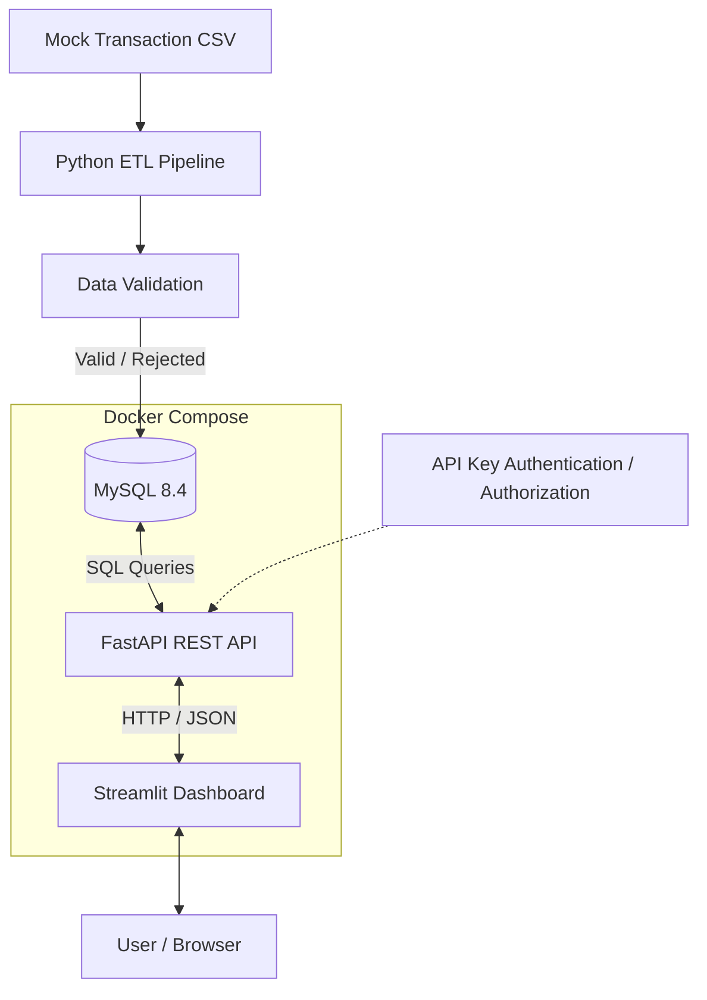

# FinOps Data Platform — System Architecture

## 1. System Overview

FinOps Data Platform은 Python과 MySQL을 기반으로 금융 거래 데이터를 생성·검증·적재하고, REST API와 대시보드를 통해 거래 및 데이터 품질 현황을 조회하는 금융 데이터 서비스 프로젝트입니다.

프로젝트는 두 단계로 개발되었습니다.

- **V1 — ETL Data Pipeline:** 모의 금융 거래 데이터 생성, 검증, 적재, 중복 방지, 오류 기록, 트랜잭션 관리
- **V2 — Financial Data Service:** FastAPI 기반 데이터 조회, 인증·인가, Streamlit 대시보드, Docker Compose 배포, 장애 대응

모의 금융 데이터를 활용하며 실제 은행의 운영 시스템이나 실시간 거래 처리 시스템을 구현한 것은 아닙니다.

## 2. System Architecture

### 2.1 Overall Architecture



### 2.2 Data Flow

**Data Ingestion**

1. Python으로 모의 계좌 및 거래 CSV 데이터를 생성합니다.
2. ETL 파이프라인이 CSV 데이터를 읽고 검증합니다.
3. 정상 거래 데이터는 MySQL의 `transactions` 테이블에 적재합니다.
4. 검증 실패 데이터는 `rejected_transactions`에 오류 사유와 함께 기록합니다.
5. 실행 정보와 처리 결과는 `pipeline_runs`에 저장합니다.

**Data Retrieval**

1. 사용자가 Streamlit 대시보드에서 데이터를 조회합니다.
2. Streamlit이 HTTP 요청을 FastAPI로 전송합니다.
3. FastAPI가 API Key를 검사하고 사용자 권한을 확인합니다.
4. FastAPI가 MySQL에 SQL 조회를 수행합니다.
5. SQL 결과를 JSON으로 반환합니다.
6. Streamlit이 결과를 테이블과 차트로 시각화합니다.

Streamlit은 MySQL에 직접 연결하지 않습니다.

**사용자 화면 → FastAPI → MySQL** 계층 구조를 유지하여 데이터 접근과 권한 검사를 API 서버에서 처리합니다.

## 3. V1 — ETL Data Pipeline

### 3.1 Extract

`src/generate_data.py`에서 모의 계좌 및 거래 데이터를 생성합니다.

생성 데이터는 CSV 파일로 저장되며, ETL 파이프라인의 입력으로 사용됩니다.

### 3.2 Transform & Validation

`src/validate.py`에서 다음 항목을 검증합니다.

- 필수 필드 누락
- 양의 정수가 아닌 거래 금액
- 존재하지 않는 계좌 ID
- 허용되지 않은 거래 유형
- 잘못된 거래 날짜 형식
- 공백으로만 구성된 필드

검증된 데이터는 정상 거래와 오류 거래로 분류됩니다.

계좌 존재 여부는 CSV 계좌 목록을 기준으로 검증합니다.

### 3.3 Load

`src/load.py`에서 검증 결과를 MySQL에 적재합니다.

| Table | Description |
|---|---|
| `accounts` | 계좌 정보 |
| `transactions` | 정상 거래 데이터 |
| `rejected_transactions` | 검증 실패 거래 및 오류 정보 |
| `pipeline_runs` | ETL 실행 상태와 처리 결과 |

### 3.4 Duplicate Prevention

`transaction_id`를 기본키로 사용합니다.

MySQL의 `ON DUPLICATE KEY UPDATE`를 이용하여 동일 거래 ID가 다시 적재되지 않도록 구현했습니다.

중복 거래는 신규 적재 건수와 구분하여 집계합니다.

### 3.5 Transaction Management

파이프라인은 다음 순서로 실행됩니다.

1. CSV 데이터를 읽고 검증합니다.
2. `pipeline_runs`에 `RUNNING` 상태를 기록하고 COMMIT합니다.
3. 정상 거래와 오류 거래를 적재합니다.
4. 실행 상태를 `SUCCESS`로 변경합니다.
5. 모든 적재 작업을 COMMIT합니다.

적재 중 예외가 발생하면 다음과 같이 처리합니다.

1. 미확정 데이터 변경을 ROLLBACK합니다.
2. 해당 실행 이력을 `FAILED`로 변경합니다.
3. 실패 상태를 별도로 COMMIT합니다.

이를 통해 적재 도중 오류가 발생했을 때 미확정 데이터의 일부만 저장되는 상황을 방지합니다.

### 3.6 Execution Tracking

`pipeline_runs`에 다음 정보를 기록합니다.

- Run ID
- Source filename
- SHA-256 source hash
- Start timestamp
- Finish timestamp
- Input count
- Inserted count
- Duplicate count
- Rejected count
- Execution status

정상 실행에서는 다음 조건을 만족해야 합니다.

```text
input_count =
    inserted_count
  + duplicate_count
  + rejected_count
```

## 4. V2 — FastAPI Backend

### 4.1 REST API

FastAPI를 이용하여 MySQL에 저장된 데이터를 HTTP API로 제공합니다.

| Method | Endpoint | Description |
|---|---|---|
| GET | `/health` | API 상태 확인 |
| GET | `/health/db` | 데이터베이스 연결 확인 |
| GET | `/api/v1/accounts` | 계좌 목록 조회 |
| GET | `/api/v1/accounts/{account_id}/transactions` | 계좌별 거래 조회 |
| GET | `/api/v1/transactions` | 전체 거래 조회 및 필터링 |
| GET | `/api/v1/analytics/summary` | 전체 거래 통계 |
| GET | `/api/v1/pipeline/runs` | 파이프라인 실행 이력 |
| GET | `/api/v1/data-quality/summary` | 데이터 품질 통계 |

현재 모든 API 엔드포인트에는 API Key 인증이 적용되어 있습니다.

### 4.2 Pagination

전체 거래 조회 API에 페이지네이션을 적용했습니다.

```python
page: int = Query(1, ge=1)
size: int = Query(10, ge=1, le=100)
```

OFFSET은 다음과 같이 계산합니다.

```python
offset = (page - 1) * size
```

SQL의 `LIMIT`과 `OFFSET`을 이용하여 요청한 페이지에 해당하는 데이터만 조회합니다.

이를 통해 하나의 요청에서 반환하는 거래 데이터의 개수를 제한합니다.

### 4.3 Transaction Filtering

거래 조회 API는 다음 필터를 지원합니다.

- `start_date`
- `end_date`
- `transaction_type`

날짜 필터는 시작일과 종료일을 포함하도록 처리합니다.

`start_date`가 `end_date`보다 늦으면 HTTP 422를 반환합니다.

### 4.4 SQL Query Handling

MySQL Connector/Python을 사용하여 데이터베이스에 접근합니다.

SQL 쿼리에서는 파라미터 바인딩을 사용합니다.

```python
cursor.execute(
    "SELECT * FROM accounts WHERE account_id = %s",
    (account_id,)
)
```

사용자 입력값을 SQL 문자열에 직접 연결하지 않아 SQL Injection 위험을 줄입니다.

DB 작업이 끝나면 커서와 연결을 닫도록 구현했습니다.

## 5. Authentication & Authorization

### 5.1 API Key Authentication

HTTP 요청 헤더의 `X-API-Key`를 이용하여 인증합니다.

```http
X-API-Key: <your-api-key>
```

API Key는 환경변수에서 읽어옵니다.

- `VIEWER_API_KEY`
- `ADMIN_API_KEY`

API Key 비교에는 `secrets.compare_digest()`를 사용합니다.

실제 API Key는 GitHub에 업로드하지 않습니다.

### 5.2 Role-Based Access Control

사용자 권한은 Viewer와 Admin으로 구분합니다.

| Function | Viewer | Admin |
|---|---|---|
| 거래 내역 조회 | O | O |
| 계좌 정보 조회 | O | O |
| 거래 통계 조회 | O | O |
| 데이터 품질 조회 | O | O |
| 파이프라인 실행 이력 | X | O |

접근통제는 Streamlit 화면이 아니라 FastAPI 서버에서 수행합니다.

### 5.3 Sensitive Data Masking

Viewer 권한으로 조회하는 경우 계좌 ID를 마스킹합니다.

예시:

```text
Original: ACC000123
Masked:   *****0123
```

계좌 ID의 마지막 네 자리만 표시합니다.

이 마스킹은 응답 데이터 노출을 줄이기 위한 기능이며, 개별 사용자의 계좌 접근 권한을 제한하는 기능은 아닙니다.

### 5.4 Authentication Error Handling

| HTTP Status | Description |
|---|---|
| 401 | API Key 누락 또는 불일치 |
| 403 | 접근 권한 부족 |
| 404 | 존재하지 않는 계좌 |
| 422 | 잘못된 요청 파라미터 |
| 503 | DB 연결 장애 또는 인증 설정 오류 |

API Key 방식은 프로젝트 학습을 위한 기본 인증 구조이며, 실제 금융기관의 운영 보안 수준을 의미하지 않습니다.

## 6. Streamlit Dashboard

Streamlit을 이용하여 금융 거래 및 데이터 품질 현황을 시각화합니다.

대시보드는 FastAPI를 통해 데이터를 조회합니다.

### 6.1 Overview

다음 정보를 표시합니다.

- 전체 거래 건수
- 전체 거래 금액
- 입금 건수
- 출금 건수
- 거래 유형별 분포 차트

### 6.2 Transactions

다음 기능을 제공합니다.

- 거래 목록 조회
- 거래 유형 필터
- 시작일 및 종료일 필터
- 페이지네이션
- 거래 데이터 테이블

### 6.3 Data Quality

다음 정보를 제공합니다.

- 검증 실패 데이터 건수
- 파이프라인 총 실행 횟수
- 중복 거래 집계
- 성공 및 실패 실행 횟수
- 실행 상태 시각화
- 최근 파이프라인 실행 이력

파이프라인 실행 이력은 Admin 권한으로만 조회할 수 있습니다.

Viewer가 접근하면 권한 안내 메시지를 표시합니다.

## 7. Docker Compose Deployment

### 7.1 Container Architecture

Docker Compose로 다음 세 가지 서비스를 구성했습니다.

| Service | Technology | Description |
|---|---|---|
| db | MySQL 8.4 | 금융 거래 데이터 저장 |
| api | FastAPI | 데이터 조회 및 접근통제 |
| dashboard | Streamlit | 사용자 화면 |

실제 Compose 설정 파일은 `compose.yaml`입니다.

### 7.2 Container Networking

컨테이너는 Docker Compose 내부 네트워크에서 서비스 이름으로 통신합니다.

```text
Streamlit
    |
    | http://api:8000
    v
FastAPI
    |
    | DB_HOST=db
    v
MySQL
```

Docker 환경에서 `localhost`는 해당 컨테이너 자신을 의미하므로 서비스 이름을 사용합니다.

### 7.3 Startup Dependencies

MySQL 컨테이너에 Health Check를 적용했습니다.

FastAPI는 MySQL 서비스가 Healthy 상태가 된 이후 실행되도록 구성했습니다.

Streamlit은 FastAPI 서비스에 의존하도록 구성했습니다.

### 7.4 Environment Variables

데이터베이스 연결 정보와 API Key를 환경변수로 관리합니다.

Docker 환경에서는 `.env.docker`를 사용합니다.

실제 비밀번호와 API Key를 GitHub에 업로드하지 않습니다.

### 7.5 Data Persistence

MySQL 데이터 보존을 위해 Docker Volume을 사용합니다.

```text
mysql_data:/var/lib/mysql
```

컨테이너를 중지하거나 재생성하더라도 볼륨을 유지하면 데이터가 보존됩니다.

단, `docker compose down -v`는 볼륨을 삭제할 수 있으므로 주의해야 합니다.

처음 실행하는 환경에서는 데이터베이스 스키마 초기화와 CSV 데이터 적재가 별도로 필요합니다.

## 8. Error Handling & Operational Logging

### 8.1 Database Connection Failure

DB 연결 실패 시 `/health/db` API에서 HTTP 503을 반환합니다.

```json
{
  "detail": "Database unavailable"
}
```

정상 연결이 확인되면 다음 결과를 반환합니다.

```json
{
  "database": "connected"
}
```

### 8.2 Error Logging

DB Health Check에서 MySQL 연결 오류가 발생하면 Python `logging` 모듈을 통해 오류 클래스 이름을 기록합니다.

```python
logger.error(
    "Database health check failed: %s",
    e.__class__.__name__
)
```

예외 클래스 이름을 기록함으로써 오류 종류를 구분할 수 있습니다.

API Key와 DB 비밀번호 등의 비밀정보는 로그에 기록하지 않습니다.

### 8.3 Failure Recovery Verification

Docker 환경에서 다음 장애 시나리오를 검증했습니다.

1. 정상 상태에서 DB 연결 확인
2. MySQL 컨테이너 중지
3. API에서 HTTP 503 반환 확인
4. Docker 로그에서 DB 연결 오류 확인
5. MySQL 컨테이너 재시작
6. DB 복구 후 HTTP 200 반환 확인

이를 통해 데이터베이스 장애를 재현하고 API 응답과 로그를 이용해 원인을 추적하는 과정을 검증했습니다.

## 9. Testing & Verification

### 9.1 Automated Tests

pytest로 데이터 검증, 인증·인가, 파이프라인 장애 처리, API 동작을 검증합니다.

기존 테스트에서는 다음 항목을 확인했습니다.

- 정상 및 비정상 거래 검증
- 필수값 누락 및 공백 검증
- API Key 누락
- 잘못된 API Key
- Viewer/Admin 권한 구분
- Viewer 계좌 ID 마스킹
- 파이프라인 실패 처리

2026년 11월 13일 기준 기존 테스트 실행 결과:

```text
19 passed, 1 warning
```

추가로 API 테스트 5개를 작성해 다음 항목을 검증했습니다.

- 페이지네이션
- 잘못된 페이지 번호
- 잘못된 날짜 범위
- 존재하지 않는 계좌 조회
- DB 연결 장애 시 HTTP 503

추가 테스트 통과는 로컬 실행 결과로 확인했습니다. GitHub 반영 여부는 별도 확인이 필요합니다.

### 9.2 Database Consistency Verification

MySQL Workbench에서 직접 실행한 거래 집계 SQL과 FastAPI의 `/api/v1/analytics/summary` 응답을 비교했습니다.

검증 항목:

- `total_transactions`
- `total_amount`
- `deposit_count`
- `withdrawal_count`

동일한 로컬 MySQL 데이터베이스를 기준으로 네 항목이 모두 일치하는 것을 확인했습니다.

### 9.3 Test Scope

모의 DB를 이용한 자동화 테스트는 API의 요청·응답 및 예외 처리 동작을 검증합니다.

실제 DB와의 연결, SQL 집계 결과 및 Docker 장애 복구는 별도의 수동 테스트로 검증했습니다.

따라서 모든 시스템 동작이 End-to-End 자동화 테스트로 검증된 것은 아닙니다.

## 10. Current Limitations & Future Improvements

현재 프로젝트에는 다음 한계가 존재합니다.

- 실제 금융기관 수준의 인증·인가 미구현
- 계좌별 사용자 접근 권한 관리 미구현
- 실제 금융 거래 데이터가 아닌 모의 데이터 사용
- API Key 교체 및 감사 추적 기능 부재
- 전체 End-to-End 자동화 테스트 미완성
- 비정상 프로세스 종료 후 `RUNNING` 상태 자동 복구 미구현
- 대용량 데이터 처리 최적화 미구현
- 자동 스케줄링 미구현
- 중앙 집중식 모니터링 미구현
- 클라우드 배포 미구현
- 날짜별 거래 추이 및 오류 유형별 세부 차트 미구현

향후에는 다음 기능을 추가할 수 있습니다.

1. CI/CD 기반 자동 테스트 및 배포
2. 데이터 처리 성능 측정과 Batch Insert 최적화
3. 중앙 집중식 로그 및 모니터링
4. 사용자별 접근통제 강화
5. 파이프라인 스케줄링과 장애 복구 자동화

## 11. Conclusion

FinOps Data Platform은 금융 거래 데이터의 생성·검증·저장부터 API 조회, 인증·인가, 대시보드 시각화, Docker 기반 실행 및 장애 대응까지 연결한 프로젝트입니다.

V1에서는 데이터 무결성, 중복 처리, 트랜잭션 관리에 집중했고, V2에서는 저장된 데이터를 실제 서비스 형태로 제공하기 위한 API 설계, 접근통제, 운영 및 테스트 기능을 확장했습니다.

이를 통해 Python, MySQL, FastAPI, Streamlit, Docker, pytest를 활용한 데이터 중심 백엔드 서비스 개발 과정을 경험했습니다.
